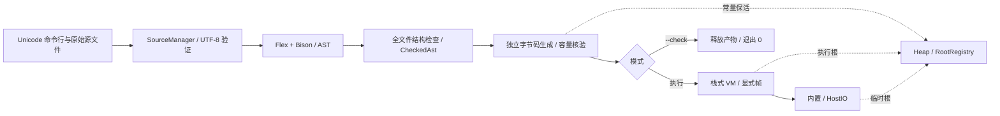

# MYB 解释器设计

日期：2026-10-22。当日状态：**用户已整体批准的解释器设计，尚未实现或执行验收**。

用户于 2026-10-22 明确回复“我批准这个计划”，并要求将文件直接放入 docs 后重新命名，现采用本文件路径。此次批准包含具体接口、资源默认值、数值依赖及 Q01/Q02；正文中的“建议/推荐”表示本次采用的设计安排，不再表示等待逐项批准。实施时仍须完成文中尚未实测的项目及固定版本依赖的核验。

2026-10-26，用户确认将错误调用链改为按内到外输出：先列最内层用户函数，再逐层列出调用者。确认经过见[解释器设计讨论记录](discussions/MYB解释器设计讨论记录.md) §4.28。

2026-10-28，同步缺陷修复中的执行索引归属、构造匹配预计算及入口路径缓存。批准日期和语言语义保持原记录；本轮实现与验证进展见[需求覆盖表](../reports/需求覆盖表.md)“2026-10-28 缺陷修复回归”。

## 设计依据与审阅范围

本稿把已讨论的架构落实为可据以编写实施计划的接口、数据结构和算法。语言行为以 [MYB 语言规范 v0.2](MYB语言规范.md) 的 D01–D72 为准，课程目标见 [原始需求](../requirements/原始需求文档.md)。[解释器设计讨论记录](discussions/MYB解释器设计讨论记录.md) §4.1–4.26 保存用户逐轮确认的路线及参考依据；语言讨论历史仍单独保存。

MYB 是小型通用脚本语言，用户执行 `myb file.myb` 即可。首版服务于数据处理与终端交互应用，先支持 Windows，平台能力与语言核心分离。宿主使用 C++20，前端 Flex/Bison 构造 AST，全文件结构检查后由独立生成器生成栈式字节码，再由 VM 执行。普通变量动态改绑，结构字段写入受约束；不增加全局静态类型系统。

本次整体批准包含以下具体安排；后续以这些安排为实施依据，必要修订同步本文件与相关记录。

| 项目 | 已批准的安排与影响 |
|---|---|
| 接口与数据布局 | SourceSpan、AST 字段、Visitor 协议、Instruction、副表、Frame、RootRegistry 与 NativeFn 的具体安排 |
| Q01：源码换行补足 | CRLF/LF 外接纳单独 CR，U+2028/U+2029 不作为源码换行；已同步语言规范的 D63 澄清 |
| Q02：控制台 EOF | 行输入中仅含 Ctrl+Z 的一整行按 EOF 处理，管道/文件 0x1A 仍为数据；须实测终端组合 |
| 数值实现依赖 | fast_float 解析、Ryu 最短显示，封装在 DecimalCodec；Ryu 小型 C99 目标与 C++20 核心一起构建 |
| 资源默认值 | AST 高度最多 256；GC 初始/最小阈值 1 MiB、存活量倍数 2；值区等宿主向量按 1.5 倍增长；不另设固定 MYB 递归层数或总内存配额 |
| 工程接入 | CMake 3.24+、Ninja 1.11+、Python 3.10+ 为已确认的支持版本范围；构建目标、CLI 解析及 JSON 黑盒 manifest 具体格式 |

本稿中的 C++ 声明只说明接口契约，不是可直接编译的完整头文件。示例输出均为规范推导，当前没有 MYB 解释器可执行证据。编译器/Flex/Bison 的既有最小兼容性测试不能代替本稿的实现验收。

首版不增加 REPL、模块导入、闭包/一等函数、用户异常捕获、字节码文件格式、类型专用优化指令或包管理。随机数、计时、非阻塞按键及终端绘制仍是后续独立语言能力讨论；本稿不替它们决定游戏实现。

## 模块、依赖与完整执行链

| 模块 | 输入 → 输出 | 责任与依赖 |
|---|---|---|
| 入口与驱动 | Unicode argv → 运行模式、退出状态 | CLI、Session 寿命、阶段切换；不解析 MYB 语法 |
| 源码与诊断 | 原始字节/SourceSpan → 源码记录/文本诊断 | 严格 UTF-8、行索引、首错；不执行用户代码 |
| 前端与 AST | SourceId → unique_ptr<AstProgram> | reentrant Flex、Bison、树形所有权；借用 SourceManager |
| 结构检查与绑定布局 | AST → CheckedAst、声明/字面量侧表 | 全文件结构合法性、声明点解析、槽位分配；不推断运行值 |
| 字节码生成 | CheckedAst → CompiledProgram | 指令、副表、位置、容量分析；借用受保护 Heap 建常量 |
| VM | CompiledProgram → 程序副作用或首错 | 动态运算、统一值区、显式帧、遍历及清理 |
| 运行时与 Heap | Value/受控请求 → 对象、根与回收 | Value、Schema、受保护分配、非移动标记—清除 |
| 内置与宿主适配 | 实参 → 根槽结果/宿主副作用 | 21 个内置、数值和文本辅助；HostIO 隔离平台 API |



执行链必须是读取 → 编码验证 → 全文件扫描解析 → 全文件结构检查 → 所有单元字节码生成与内部核验 → 执行。任一执行前阶段失败，连文件前部的 print 都不得执行。`--check` 在生成和内部核验成功后释放产物，不进入 VM、不读取程序 stdin、不调用内置、不写出字节码。

阶段接口推荐为 `Driver::parse()`、`Checker::check(const AstProgram&)`、`BytecodeCompiler::compile(const CheckedAst&, CompiledProgram&)`、`VM::execute(const CompiledProgram&)`。编译器写入 Session 内地址稳定的 CompiledProgram，避免生成期根提供者指向一个随后移动的返回值。失败通过下文的专用故障对象传播，不返回可执行的半成品。

### 会话寿命与共享约定

一个 CLI 命令对应一个单线程 Session，不并行执行 MYB、不允许内置重入 VM。RootRegistry 先于所有根创建、最后销毁。SourceManager 和 Program/Schema 均覆盖执行和诊断所需寿命，Heap 对象地址不搬移；VM、全局表、常量提供者和宿主临时集合分别登记根。

生成完成后可释放 CheckedAst 与 AST；编译产物不得借用其名称或节点。统一边界在状态仍可用时保存诊断，随后执行无分配清理：结束活动遍历、清空帧/全局及编译临时根、销毁 VM；撤销 ProgramConstants 根；禁止后续 GC 并清空 Heap；再销毁 Heap、Program/Schema、SourceManager 和 RootRegistry。诊断记录只保存独立拥有的宿主文本副本及值类型元数据，不借用受管 Value；低内存时只保留固定首错记录。实际对象清空早于 Schema 销毁，根注销早于 Registry 销毁。

Value 的普通赋值、参数和返回都复制值表示，对象引用保留共享；浅切片仅新建外层数组，只有显式 deep_copy 复制可变对象图。对象地址稳定与向量元素地址稳定是两回事；跨可能增长或回收的接口使用根和索引，不保留内部槽位地址。

## 源码、位置与前端产物

本部分沿用已确认的 Flex/Bison→AST→全文件结构检查流程。下列 C++ 名称、字段、256 层 AST 限制及单独 CR 处理已随整份设计获批，不表示已经实现或通过工具链验证。

### 源码与位置接口

`SourceManager` 在本次命令期间拥有源码记录；源码读取不经过 Windows 文本换行转换，保留开头 BOM 及全部原始字节。记录发布后字节不可修改，程序编译产物和运行诊断存续期间 `SourceManager` 同样存活。首版只有一个入口源文件，`SourceId` 仍用于明确位置归属，不意味着支持 import。

```cpp
using SourceId = std::uint32_t;
struct SourceSpan {
    SourceId source;
    std::uint64_t begin; // 原文件字节偏移，包含
    std::uint64_t end;   // 原文件字节偏移，不包含
};
struct SourcePosition { std::uint64_t line, column; };
struct SourceFile {
    std::string path_utf8;
    std::string bytes;
    std::vector<std::size_t> line_starts;
    std::size_t bom_size;
};
class SourceManager {
public:
    SourceId add(std::string path_utf8, std::string bytes);
    const SourceFile& get(SourceId) const;
    SourcePosition locate(SourceId, std::uint64_t offset) const;
    std::string_view slice(SourceSpan) const;
};
```

`add` 先保存记录，再严格验证 UTF-8、建立行索引，成功后才允许扫描。非法序列定位其起始字节，行列由之前的合法前缀计算；不替换错误字节后继续。输入尺寸须能同时表示为 `size_t` 和 `uint64_t`，偏移加法、缓冲区额外两字节及容器上限都在分配前检查。源码路径是已完成 Windows 宽字符桥接的 UTF-8 文本，不将 ANSI 窄字符串解释为 UTF-8。

行列从 1 开始，列是从当前行起点到目标位置之前的 Unicode 码点数加一；Tab、组合字符各计一个码点，不以终端格宽计列。开头一个 BOM 保留字节但不计显示列，故 BOM 后第一个字符为 1:1；其他位置的 BOM 不作特殊跳过。CRLF 算一次换行。**已确认 Q01：单独 CR 也作为源码换行；LF、CRLF、CR 都记录下一行起点，U+2028/U+2029 不自动成为源码换行。** 字符串转义按源文件实际字符定位，运行时字符串的码点数不参与源码定位。

`locate` 先以行起点二分找行，再扫描该行合法 UTF-8 前缀；第一版不为每个字符建立索引。指向 CRLF 内部的内部错误位置归前一行行尾，扫描器不在两字节中间生成正常 token 边界。EOF 为 `[bytes.size(), bytes.size())`，空文件也具有合法的 1:1 EOF。`SourceSpan` 的合并要求同一 `SourceId`；源码越界、跨文件合并属于宿主不变量错误，不伪装成 MYB 语法错误。

### 扫描器、Driver 与 Bison 适配

`Driver` 是一次解析的协调对象，借用 `SourceManager`、保存本次 `SourceId`，独占 `Scanner` 及待交付的 `unique_ptr<AstProgram>`。`parse()` 成功返回整棵树；任何异常都不交付部分结果。解析器、扫描器不创建全局运行时变量、不调用 MYB 内置，也不创建运行时 Array/Struct 对象。

```cpp
struct IntLexeme { std::string digits; };
struct FloatLexeme { std::string text; };
struct ScannerContext {
    SourceId source;
    std::uint64_t consumed;
    SourceSpan matched;
    std::uint64_t string_begin;
    std::string decoded_string;
    FlexAllocationLedger allocations;
};
// Scanner 私有持有句柄、YY_BUFFER_STATE、可写输入副本及上述上下文。
// Scanner 不可复制、不可移动；析构 noexcept。
Parser::symbol_type raw_lex(yyscan_t scanner);
Parser::symbol_type yylex(Driver& driver); // 调用该 Driver 的 Scanner::next()
std::unique_ptr<AstProgram> Driver::parse();
```

Bison 使用 `%skeleton "lalr1.cc"`、`%define api.value.type variant`、`%define api.token.constructor`、`%locations` 和 `%define api.location.type {myb::SourceSpan}`。`%parse-param` 与 `%lex-param` 均显式传入 `Driver&`；解析器调用上面的 `yylex(Driver&)`。词法入口返回完整 `Parser::symbol_type`，例如 `make_IDENTIFIER(owned_name, span)`、`make_INT(IntLexeme, span)`；不启用 `bison-bridge`、`bison-locations`，不分传 `yylval/yylloc`。自定义 `YYLLOC_DEFAULT` 将非空产生式的位置合并为首符号起点至末符号终点，空产生式使用前一个符号末尾的空范围；通过 `%initial-action` 将初始位置设为该 SourceId 的源码起点。

Flex 使用 reentrant C 后端，以 C++20 编译；句柄私有，不泄露到 AST 或编译产物。用 `yyextra` 保存 `ScannerContext*`，不依赖可变全局。使用 `yy_scan_buffer`，输入为 `Scanner` 拥有的原字节副本加两个 NUL 哨兵；缓冲区存在期间不移动或扩容。原文件内部 NUL 仍是输入字符，不是 EOF。这里选择副本换取清楚的尺寸与所有权，不借用或修改 `SourceManager` 的不可变字符串；避免 `yy_scan_bytes` 的入口长度窄化与 `yy_scan_string` 的 NUL 截断。M1 核验 Flex 2.6.4 生成源码后确认，`yy_scan_buffer` 内部仍将字节长度保存为 int；因此复制前显式核验源码不超过 INT_MAX 字节，超限为 Resource/Capacity（退出 3），不因接口参数是 size_t 而承诺超出生成后端的容量。

`YY_USER_ACTION` 按当前规则实际匹配的 `yyleng` 字节建立 `matched` 并推进 `consumed`；预读、缓冲填充不改变源码位置。规则不使用 `REJECT`、`yymore`、`yyless`、`unput`，因此位置只前进一次；开启 `noinput nounput noyywrap nodefault`。跳过空白、注释和开头 BOM 的规则同样推进。字符串使用独立扫描状态，记录开引号偏移，各片段都更新消费位置，闭引号返回涵盖整个字面量的范围。源 UTF-8 已验证；转义解码仍检查未知转义、1–6 位 `\u{HEX}`、标量上限及代理区，字符串不能直接跨任何获接纳的源码换行。

标识符、数字词素在返回 token 前复制为拥有存储的字符串；字符串 token 携带已解码 UTF-8。任何长期对象不保存 `yytext` 指针。整数先携带十进制词素，不在扫描阶段将所有超过 `INT64_MAX` 的幅值一律拒绝，以保留最小负整数例外。数字规则还拒绝 `12abc`、不完整指数及不支持的进制；合法浮点必须满足规范文法。连续的 `++`、`--`、`+=` 等不支持运算符由专门规则拒绝，不能拆成多个单字符 token 绕过规则；合法的分隔运算符仍按文法处理。

正常 `<<EOF>>` 显式返回 `make_YYEOF(eof_span)`，并适配默认 `yyterminate`，不让完整 symbol 接口落入整数返回。字符串状态遇 EOF 报未闭合字符串，非法字符由 catch-all 规则报词法错误；对已验证 UTF-8 中不合法的非 ASCII 源码字符一次消费完整码点，避免把诊断范围截在多字节字符内部，不使用默认 ECHO。`Parser::error` 和词法错误抛出保存 `SourceSpan` 的 `FrontendFailure`，不做恢复；解析器栈上的 variant/`unique_ptr` 自动释放。

`YY_FATAL_ERROR` 改为抛出宿主故障，禁止 `exit/abort/longjmp`：分配/容量 fatal 为 `HostFailure(Resource, Allocation/Capacity)`，scanner jam 或内部状态 fatal 为 `HostFailure(Internal, Invariant)`，均退出 3，不套用用户词法错误的 FrontendFailure/1。Flex 的 `yyalloc/yyrealloc/yyfree` 使用本扫描器的私有分配登记：正常释放撤销登记，初始化或 fatal 中尚未挂入生成器结构的分配仍由登记兜底释放。登记失败先释放新块，再传播资源不足；`realloc` 失败保留原块登记。先销毁已初始化扫描状态，再清扫剩余登记，最后释放输入副本；这些清理不抛异常。实现阶段必须核对本机 Flex 2.6.4 生成路径，避免仅凭 `yylex_destroy` 假定部分初始化绝无遗漏。

## AST 节点与只读访问协议

### 所有权与节点字段

`AstProgram` 持有源码顺序的顶层项目。`Stmt` 也是 `TopItem`，因此顶层可以混排声明与语句；块只持有 `Stmt`，文法层面阻止嵌套函数/结构。所有节点拥有 `SourceSpan`、构造时确定的 `uint16_t height`，以及必要的操作符/名称位置；父节点用 `unique_ptr` 独占子节点，序列用 `vector<unique_ptr<...>>`。Node 明确提供 `virtual ~Node() noexcept = default`，派生析构不抛异常，确保经基类指针删除时完整清理子树。名称、字面量载荷拥有存储，不借用扫描缓冲。

| 具体节点 | 拥有的语义字段 |
|---|---|
| `AstProgram` | `vector<unique_ptr<TopItem>> items` |
| `FunctionDecl` | 名称及位置；有序参数名称/位置；`unique_ptr<BlockStmt> body` |
| `StructDecl` | 名称及位置；有序 `FieldDecl{name, name_span, TypeRef}` |
| `IntExpr` / `FloatExpr` / `StringExpr` | 原整数词素 / 原浮点词素 / 已解码 UTF-8 字符串 |
| `BoolExpr` / `NullExpr` / `NameExpr` | Bool 值 / 无额外载荷 / 名称及位置 |
| `GroupExpr` | 内部表达式；保留括号覆盖范围 |
| `UnaryExpr` | `UnaryOp{Plus,Minus,Not}`、操作符位置、操作数 |
| `BinaryExpr` | 算术或六种比较操作、操作符位置、左右表达式 |
| `LogicalExpr` | `LogicalOp{And,Or}`、操作符位置、左右表达式 |
| `CallExpr` | 被调用名称及位置、有序实参；不存普通 callee 表达式 |
| `ArrayExpr` | 有序元素表达式 |
| `ConstructExpr` | 类型名及位置、有序 `FieldInit{name, name_span, value}` |
| `FieldExpr` | 接收表达式、字段名及位置、访问位置 |
| `IndexExpr` | 接收表达式、下标表达式、访问位置 |
| `SliceExpr` | 接收表达式、可空起点指针、可空终点指针、访问位置 |
| `LetStmt` | 名称及位置、可空初始化表达式 |
| `AssignStmt` | 原始左侧表达式、右侧表达式、赋值符位置 |
| `ExprStmt` / `BlockStmt` | 表达式 / 有序语句列表 |
| `IfStmt` | 条件、then 块、可空 else 语句（仅 `IfStmt` 或块） |
| `WhileStmt` | 条件、循环体块 |
| `ForStmt` | 循环变量名称/位置、来源表达式、循环体块 |
| `ReturnStmt` / `BreakStmt` / `ContinueStmt` | 可空返回表达式 / 无额外载荷 / 无额外载荷 |

`TypeRef` 是值记录 `{name, nullable, span}`，`FieldDecl/FieldInit` 是所属节点内部记录，不独立引入可被普通变量读取的运行时 Value。切片空指针表示省略端点，与显式 `NullExpr` 区别；无初始化和无返回表达式同样用空指针表示。构造字段保持源码顺序与重复项，不能先放 map 去重；字段声明顺序另行保存。数组、实参、参数均不接受尾随逗号，不额外创建“空语句”节点。

表达式保留 `GroupExpr`，直到结构检查完成也不删除。赋值目标由检查器只剥去最外层分组，然后确认最终节点属于 `NameExpr`、`FieldExpr` 或 `IndexExpr`；生成器使用“写入位置”入口，不对最终目标先做普通读操作。中间接收表达式仍正常求值，故 `(make_array()[0]) = value;` 可按索引写入，`a[:] = value;`、计算结果、调用结果本身不可赋值。

所有节点通过工厂构造，`height = 1 + max(直接子节点.height)`，叶为 1，空程序/空块同为 1，兄弟节点数量不累加。**本次建议 AST 根到叶最多 256 个节点**，计入 `AstProgram`、声明、块、分组等真实节点，不额外把参数/字段值记录当节点；工厂在把子树连接为新父节点之前检查，超限按宿主资源边界拒绝，退出 3，而非改变语法。Bison 的自动归约不视为新增 AST 层；本稿不创建无用途的合成 AST 节点。每个已构造子树都满足上限，使失败清理、只读访问及递归析构不会先处理一个未经限制的深树。256 是待实现验证的默认资源值，没有性能或栈容量实测。

### Visitor 返回协议与阶段状态

`AstVisitor` 提供虚 noexcept 析构，并对每个具体节点声明一个纯虚 `void visit(const ConcreteNode&)`；`Node::accept(AstVisitor&) const` 只进行类型分派，不递归。程序、声明、表达式和语句均有对应入口，不提供默认空实现或 catch-all 成功分支；新增节点时检查器和生成器都必须补齐处理，否则无法实例化对应 Visitor。

所有孩子通过 `const Expr&`、`const Stmt&` 及只读序列访问，不公开可以从 `const unique_ptr<T>` 取得可变 `T*` 的容器接口。语法动作在构造期移动所有权，解析完成后树只读。节点无检查器/生成器状态，也不持有运行时帧、变量 Value 或堆对象。

检查器返回协议为 `CheckedAst = {borrowed AstProgram, owned DeclarationIndex, owned LiteralTable}`；失败抛 `FrontendFailure`，不返回“带错误但可执行”的部分结果。字节码生成器的 `visit` 同样返回 void，通过独立的当前代码单元、标签、栈效应与作用域状态输出；`emit_expr(const Expr&)` 保证成功后压一个值，`emit_stmt(const Stmt&)` 保证正常落出栈深不变，赋值目标另走 `emit_store_target`。不以一套全局“上次表达式结果”变量模拟返回，也不让 Node 固定递归顺序。

检查辅助表可以临时以 `const Node*` 为键，前提是其所属 `CheckedAst` 不超过 AST 寿命。生成完成后先得到完全独立的编译产物，再释放辅助表及 AST；编译后函数、字段、常量、源码映射拥有独立存储，不能留下节点地址、字符串视图或词法缓冲引用。`SourceManager` 单独保留至程序结束。

## 全文件结构检查与字面量规范化

### 三遍检查与登记

检查在全部解析成功后开始，覆盖未执行分支及未调用函数；遇首个检测到的失败终止，不承诺跨阶段挑出字节位置最靠前的错误。第 1 遍按顶层源码顺序收集函数、结构和顶层直接 `let` 的名称，结合 21 个内置及 `Int64/Float64/Bool/String/Array` 检查全局名称冲突；函数/结构取得稳定编号。这里收集 `let` 只是声明合法性检查，既不建立运行时全局绑定，也不预置其初始化状态。

第 2 遍在所有结构名已知后检查结构字段：同一结构不得重复字段名；类型只能是五个已支持基类型或已登记结构，允许一个 `?`。保存字段声明顺序及解析后的 `FieldType{base_kind, optional_struct_id, nullable}`，支持前向、自身和相互引用；不构造实例，不追踪递归展开，不将 `Null` 当基类型。函数固定形参数量来自有序参数列表，不在登记时执行函数体。

第 3 遍以只读 Visitor 检查所有语句和表达式。每个词法作用域维护自己的声明集合；函数参数和函数体最外层共用集合，循环变量和当轮 `for` 体最外层共用集合，独立块另开集合。分支各有自己的块。参数重名、同层重复 `let`、声明/参数/循环变量使用受保护函数/类型/内置名称均执行前拒绝；普通名称内层遮蔽允许。函数检查上下文独立设置 `in_function=true`、`loop_depth=0`，防止非法 `return` 或跨函数的 `break/continue`。对 for 先遍历来源，再开启含循环变量的体作用域。

检查器依声明的词法位置处理集合，但不据此证明任何实际读取能成功。函数检查不继承调用者的局部声明；顶层块的局部也不是函数全局。第 1 遍登记的顶层 `let` 集合不能被生成器误当作已存在的运行时变量。重复结构字段与结构字段类型是声明检查；构造表达式中的缺失、重复、未知字段仍属于构造运行时预检，不能复用第 2 遍把它提前拒绝。

### 数字与写入目标处理

`LiteralTable` 以节点地址保存 `variant<int64_t,double,std::string>` 的宿主字面量数据；这不是运行时 `Value`、不含受管对象引用。整数幅值用逐位检查且限制到 `2^63` 的无符号解析，不先使用有符号取负；累计幅值超过 `2^63` 即报告字面量越界，前导零不因词素长度单独触发越界。普通 `IntExpr` 最大为 `INT64_MAX`。

`visit(UnaryExpr Minus)` 只有在**直接孩子本身为 `IntExpr`**且幅值恰好 `2^63` 时，在该 Unary 节点记录 `INT64_MIN` 规范化常量，并不再作为独立正整数访问孩子；正常空白/注释已由扫描器分隔，不影响这项判定。若孩子为 `GroupExpr` 或任何访问表达式，就走普通遍历并拒绝其中超范围正整数。生成器只对这项已记录的特殊 Unary 直接压 MIN 常量，不生成不存在的正幅值再取负；其他一元运算照常生成动态指令。

因此 `- 9223372036854775808`、`(-9223372036854775808)` 合法；`-(9223372036854775808)` 执行前失败；`-(-9223372036854775808)` 保留外层运行时取负，在实际执行处报告溢出。前导零仍十进制；这项规范化不是任意常量折叠，不把 `1/0`、MIN 再取负等运行错误提前执行。

浮点词素交给与 `float/try_float` 共用的 `DecimalCodec::parse_float`，源码模式不接受符号及首尾空白，且须完整匹配源码浮点文法；结果是最近 Float64、正中取偶，允许下溢和归零、拒绝非有限溢出，保留后续取负产生负零的行为。解析器不依赖当前 locale，也不能把宿主转换的“超出范围”结果一律当溢出，漏掉规范允许的下溢。字符串已经过词法解码，检查器只保留拥有存储的数据，待生成阶段再建立 String 常量及其根。

赋值形状检查只决定是否具有合法写入结构；不会预读目标变量、查实际数组类型/长度、验证字段是否存在。若最终目标为受保护名称，实际执行仍先求完整右侧，再在定位目标时拒绝写入，保留已确认赋值顺序；声明使用受保护名仍按前述全文件结构检查拒绝。合法形状不代表 `--check` 能证明写入成功。

### 执行前与运行时的明确边界

| 执行前拒绝 | 留给实际执行路径 |
|---|---|
| 非法 UTF-8、字符/转义/数字词素、文法错误 | 普通名称是否已声明、初始化状态 |
| 同作用域重复声明、参数重复、受保护声明冲突 | 调用目标是否存在/可调用、固定参数数量 |
| 重复函数/结构/字段声明、未知字段声明类型 | 构造目标及构造字段集合、逐项字段值检查 |
| 非法赋值目标形状、非法 return/break/continue | 实际运算/Bool条件/下标/切片/字段/遍历类型及范围 |
| 非法正整数字面量、浮点字面量非有限溢出 | 除零、整数溢出、非有限运算、I/O/断言/活动遍历禁改 |

下面完整程序说明阶段差别；结果是阅读推导，不是已执行证据。

```myb
let x = 3;
fn show() {
    print(x);
    let x = x + 1;
}
if (false) {
    missing(1, 2);
}
show();
```

语法与结构检查通过，`missing` 不因位于未执行分支而导致整文件拒绝。运行 `show` 时第一次读 x 取得全局 3；执行局部 let 时先建立未初始化的新 x，故初始化表达式读取它时报错。前端登记与槽位预分配都不能把第一次读取改为局部未初始化，也不能使第二次读取回退到全局。

本部分风险集中在：自定义位置类型的 Bison 空归约适配、Flex 部分初始化/fatal 的可清理性、直接负最小值不被 Group/访问节点误折叠、以及全文件名称收集不越过动态错误阶段。实现验证应围绕这些边界开展，不将本稿接口示意视为可直接编译的产品代码。

## 字节码生成、绑定与 VM 执行

本部分补齐首版具体接口，供集中审阅；既有语言语义及架构决定保持有效。
下述类型名、字段、操作码、容器和算法已随完整设计获批，作为实现契约生效。
它们不表示已有 C++ 实现，也不把语言运行时错误改成编译错误。

### 1. 编译产物与编号

编译后程序拥有名称池、结构描述、用户函数描述、顶层及各函数的代码单元。
名称池使用拥有内容的 UTF-8 `std::string`；标识符仍受 ASCII 标识符规则限制。
程序生命周期覆盖 VM、常量根与运行错误诊断；数据不借用已释放 AST。
源文件另由源码管理对象持有，字节码位置映射保留其文件编号及字节范围。

| 推荐类型 | 内容 |
|---|---|
| `CompiledProgram` | 名称池、结构表、函数表、代码单元表、顶层单元编号 |
| `FunctionInfo` | 名称编号、形参数量、代码单元编号、声明位置 |
| `CodeUnit` | 指令、常量、逐指令源码范围、调用点、构造方案、遍历站点、容量元数据 |
| `CallSite` | 目标名称编号、固定实参数量；错误位置由对应指令映射提供 |
| `ConstructionPlan` | 类型名称编号、按源码顺序排列的字段名称编号 |
| `IterationSite` | 循环变量局部槽位编号；循环清理范围留在生成期信息中 |

名称池建议用 `vector<string>` 与 `unordered_map<string, NameId>`，编号取得后只按编号访问，不借用可增长容器元素地址。结构表是 `vector<unique_ptr<StructSchema>>`，保证 Schema 地址稳定；函数/单元表为各自的 vector。每单元副表同样用 vector，构造方案字段不去重，以保留运行时重复字段检查。

执行索引由 VM 的 `ExecutionIndex` 持有。每次 `execute` 在发布首帧前，使用本次实际 `BuiltinRegistry` 与 `CompiledProgram` 建立只读调用目标、Schema、字段及构造方案记录；`--check` 完成生成与核验后直接返回，不进入这一步。用户函数按精确 NameId 登记，内置使用实际登记表的描述；目标记录携带类别及对应编号。执行期间程序元数据与实际内置描述表保持不变，不注册新名称。

索引拥有辅助文本、编号和槽映射，借用的 Program、Schema、内置描述及名称须覆盖本次执行。索引不持有受管 Value、不新增 GC 根，有效查询不分配或触发回收。准备先在临时索引内完成，全部成功后以无异常交换发布；容量或分配失败交统一宿主故障边界处理。每次执行重新准备，退出时在撤销 `program_` 前清除索引，旧查询引用随之失效；失败诊断所需位置与调用链先按原规则保存。

程序内名称、函数、结构、单元及单元内指令、常量、副表、槽位编号使用 `uint32_t`。
编号的归属是接口的一部分：常量、副表及跳转均由当前代码单元解释，名称属于程序。
容器长度先用 `size_t` 计算，检查可表示范围后才转为编号；禁止截断转换。
各单元的参数数、局部数及最大操作数深度也保存为已检查的 `uint32_t`。
源码字节偏移使用 `uint64_t`，VM 统一值区的绝对索引使用 `size_t`，增长前检查加法与容器边界。
这些宿主限制不增加 MYB 静态类型系统，也不承诺磁盘字节码兼容。

### 2. 指令布局与副表

推荐 `enum class Op : uint16_t`，指令保存 `Op op; uint32_t a; uint32_t b;`。
不使用的操作数字段必须置零；操作码枚举及操作数含义由一份定义集中维护。
这是普通 C++ 指令结构数组，不指定 sizeof、对齐、字节序或文件序列化布局。
每单元使用 `std::vector<Instruction>`、`std::vector<Value>` 及对应副表。
一条指令对应一个源码范围条目，便于以单元编号和指令编号定位错误。
数组、结构实例不得缓存到常量表；每次执行对应构造都产生新可变对象。
首版常量逐次添加，不建设跨单元驻留或去重；复制常量 Value 不复制其对象。
程序各单元受管常量在生成和执行期间均作为根，包括从未被调用的函数。

### 3. 绑定布局与名称解析

结构检查先验证声明位置、重复声明、受保护名称、参数及控制语句等规则。
它可以收集全部声明以检查合法性，但不得把普通变量视为已经执行了声明。
槽位布局预遍历只分配编号；名称解析另按源码顺序推进。
首版不复用同一代码单元内不同声明的局部编号，减少清理与诊断歧义。
每个词法子树的局部编号形成连续区间，父作用域区间包含子作用域。
形参位于函数局部区开头，与函数体最外层共享声明作用域。

解析普通读取及赋值目标时，使用当前已引入的局部声明栈。
先查当前块，再查函数内外层块及参数；没有可见局部时生成全局名称操作。
不搜索调用者的局部，不为尚未出现的局部声明生成提前绑定。
编译 `let name = expr;` 时先将该声明引入解析环境，再生成初始值。
运行代码同样先执行声明动作，建立未初始化绑定，再执行初始值表达式。
因此 `let x = x + 1;` 仍读取新 x，并在实际执行时报告未初始化。
声明前的同名读取已绑定到外层槽位或全局名称，不会后来被改写为新槽位。

文件直接顶层的 let 使用全局名称表；顶层嵌套块的 let 使用顶层帧的局部槽位。
全局表仅在实际执行声明动作时插入绑定，函数/结构预登记不插入这些变量。
函数体的全局读取始终查当时运行环境，不以其文本相对全局 let 的先后决定存在性。
未知变量、未知调用及未初始化读取仍生成可执行操作，不因处于未执行路径而拒绝。
受保护名称和声明重复等结构错误仍全文件拒绝，不能与运行时名称检查混淆。

### 4. 槽位状态

统一值存储另有平行的 `BindingState` 数组，局部区使用三态：
`Dormant` 表示本次执行尚未建立或已经退出的绑定；
`Uninitialized` 表示已建立但还没有语言值；
`Initialized` 表示已有可读 Value，包含合法 null。
预留、扩容和复用帧区域都初始化为 Dormant，不因物理槽位存在而建立名称。
DECL_LOCAL 将 Dormant 改为 Uninitialized，初始值写入后改为 Initialized。
局部读写先核验绑定已建立；读取再核验初始化，赋值可以初始化已有绑定。
全局表中条目不存在与条目未初始化同样分开处理。
全局具体容器建议为 `unordered_map<NameId, GlobalBinding>`，其中 GlobalBinding 保存 Value 与 BindingState；条目插入成功后才提交 DECL_GLOBAL，表本身作为稳定根提供者枚举当前已初始化值。查找缺失不能使用会自动插入默认值的 operator[]；函数/内置/结构目标表与变量表分开。
清理把槽位置为 Dormant 并把旧 Value 清为空值，去除过期引用。
GC 只枚举 Initialized 局部，不把占位 null 或旧槽内容当成有效根。
操作数区不靠 BindingState 判断有效性，而由本帧有效栈深界定。

### 5. 指令职责与栈效应

以下栈记法为执行前后有效操作数数量；失败路径没有正常后继。
Value 复制只复制标量或对象引用，所有可能分配的结果使用受保护交接。
`k` 为实参数、数组元素数或构造字段数；`m` 为显式切片端点数。

| 指令 | a、b | 正常栈效应及职责 |
|---|---|---|
| CONST | a=本单元常量号 | 0→1，复制常量 |
| DUP | 均为0 | 1→2，复制栈顶 Value |
| DROP | 均为0 | 1→0，清除表达式语句结果 |
| DECL_LOCAL | a=槽位 | 0→0，建立未初始化局部 |
| DECL_GLOBAL | a=名称号 | 0→0，实际建立未初始化全局 |
| LOAD_LOCAL / LOAD_GLOBAL | a=槽位/名称号 | 0→1，运行时存在性及初始化检查 |
| STORE_LOCAL / STORE_GLOBAL | a=槽位/名称号 | 1→0，检查已有绑定并写入 |
| CLEAR_LOCALS | a=首槽，b=数量 | 0→0，撤销区间绑定并清除值 |
| UNARY | a=正号/负号/逻辑非 | 1→1，按实际类型检查及执行 |
| BINARY | a=加/减/乘/除/整除/余数 | 2→1，先取得两值再执行动态运算 |
| COMPARE | a=六种比较之一 | 2→1，执行 MYB 数值/文本/身份规则 |
| CHECK_BOOL | 均为0 | 1→1，严格检查栈顶 Bool |
| JUMP | a=目标指令号 | 0→0，无条件转移 |
| JUMP_FALSE / JUMP_TRUE | a=目标指令号 | 1→0，检查 Bool 后按值转移 |
| PRECALL | a=调用点号 | 0→0，运行时目标及数量预检 |
| CALL | a=调用点号 | k→1，用户帧切换或宿主统一入口 |
| RETURN | 均为0 | 1→调用者1，保护返回值并统一收尾 |
| HALT | 均为0 | 要求深度0，正常结束顶层单元 |
| BUILD_ARRAY | a=元素数量 | k→1，新建外层数组并保留元素顺序 |
| CHECK_STRUCT | a=构造方案号 | 0→0，运行时类型及完整字段集合预检 |
| CHECK_FIELD | a=方案号，b=源码字段序号 | 1→1，即时检查字段值并按规则提升 |
| BUILD_STRUCT | a=构造方案号 | k→1，按已检查字段值创建实例 |
| GET_FIELD | a=字段名称号 | 1→1，按实际结构查字段 |
| GET_INDEX | 均为0 | 2→1，接收对象、索引求完后检查读取 |
| GET_SLICE | a=起/止存在位 | 1+m→1，端点求完后检查并新建切片 |
| SET_FIELD | a=字段名称号 | 2→0，右值在下、接收对象在上，检查后写入 |
| SET_INDEX | 均为0 | 3→0，右值、接收对象、索引，检查后写入 |
| ITER_BEGIN | a=遍历站点号 | 1→0，核验来源并安全登记活动遍历 |
| ITER_NEXT | a=站点号，b=耗尽目标 | 0→0，成功时建立本轮变量，否则转移 |
| ITER_END | a=站点号 | 0→0，结束当前对应遍历，恰好解除一次 |

UNARY、BINARY、COMPARE 使用通用动态分派，首版 VM 主循环推荐标准 C++ switch。
操作函数可以包含整数等简单快速分支；不生成类型专用或自适应指令。
整数溢出、向下整除、非有限浮点、严格 Bool 及跨数值比较统一调用语义辅助函数。
不得借助 C++ 带符号溢出、隐式 bool 转换或有损 int→double 比较实现语言规则。
清理不运行 MYB 回调、不分配受管对象、不触发 GC，也不抛出二次异常。

### 6. 表达式及普通赋值生成

普通二元表达式依次生成左、右，再生成运算；两侧尚未求完不提前查类型。
访问表达式依次生成接收对象及显式索引/端点，再生成对应 GET 操作。
切片 a 的两个存在位区别端点省略与显式 null，不能用 null 代替省略标记。
读取使用原接收对象当时的长度；端点副作用可以合法修改其当前内容。
每层嵌套访问独立完成：内层访问错误立即停止，外层表达式不再执行。

赋值先完整生成右侧并保留结果，然后生成左侧的最终位置。
普通名称直接 STORE，不先 LOAD 旧值，故未初始化变量也可被首次赋值。
字段目标先求接收对象，再 SET_FIELD；数组目标先求接收对象、索引，再 SET_INDEX。
最终目标的对象类型、可写性、索引类型、边界和字段约束在位置表达式求完后检查。
字符串索引写入也必须先完成索引表达式，再拒绝不可写接收对象。
中间接收对象仍是普通表达式，需要的中间 GET 按普通访问顺序执行和检查。
最外层分组只拆去语法包装，不引入旧目标读取；切片目标在结构阶段拒绝。

### 7. 短路与分支

if/while 条件生成表达式，再由条件跳转严格检查 Bool 并消费条件。
`left && right` 生成 left、DUP、JUMP_FALSE end、DROP、right、CHECK_BOOL。
`left || right` 将上式条件跳转改为 JUMP_TRUE，其余相同。
条件跳转消费复制的条件；短路路径保留原 Bool，另一条路径丢弃它再计算右侧。
因此两个正常汇合路径均留下一个 Bool，右侧未执行时不发生其运行时检查。
分支与循环条件的语法/结构检查仍覆盖所有分支，不被短路取消。
每个普通语句正常结束均回到进入它之前的操作数深度。

### 8. 调用点与构造方案

PRECALL 必须先于该次调用的全部实参，运行时解析命名用户函数或宿主内置及固定数量。
目标表在本次程序执行期间不可修改，名称也不能被普通变量覆盖。
CALL 使用同一不可变目标表及调用点；嵌套调用不需要共享一个可被覆盖的“当前目标”字段。
生成器保留 PRECALL/CALL 的配对，容量检查器核验各路径的结构关系。
未知目标或数量错误留在 PRECALL 的实际执行路径，不因生成时可知就提前拒绝。
PRECALL 成功后实参从左到右全部求值；内置值类型检查只能发生在 CALL 统一入口。
普通用户参数无类型约束，接收时不因旧值或推测类型拒绝实参。

CHECK_STRUCT 在任何初始化表达式之前检查类型存在、可构造及字段集合恰好匹配。
ConstructionPlan 保留原字段名及源码顺序，重复/未知/缺失字段均在此处报运行错误。
`ExecutionIndex` 在准备时为每个 Schema 建立字段名称到声明槽的索引，并按代码单元号、构造方案号保存 `PreparedConstruction`。其中记录 UnknownType、NotConstructible、FieldSetMismatch 或 Ready；Ready 另存 SchemaId 和按构造源码顺序排列的声明槽编号。准备只记录动态无效状态，CHECK_STRUCT 实际执行时才报告对应 Name/Type 错误；未执行分支和 `--check` 保持原动态错误阶段。

随后每求完一个字段，立即 CHECK_FIELD，检查失败不执行后续字段。
Float64 字段需要的 Int64 提升在 CHECK_FIELD 中完成，栈顶换成已检查值。
CHECK_FIELD 复用准备的槽编号，字段动态值的类型检查及提升仍逐次执行。
最后 BUILD_STRUCT 按槽映射将这些值安放到声明位置；构造表达式顺序仍是源码顺序。
字段值在操作数区保持根，创建前无需暴露未完成的实例或额外构造记录栈。
零字段结构同样执行预检并每次新建实例；结构字段或数组元素仍按共享规则保存。

准备的平均工作量随名称、声明、代码单元及构造字段总量线性增长，另计文本处理。有效构造的 CHECK_STRUCT 和单次 CHECK_FIELD 按编号直接访问，BUILD_STRUCT 按字段数完成写入。普通字段读写使用同一 Schema 的字段索引，先验证 Schema 属于当前程序；字段表查询为平均常数成本。准备及执行期计数分别验收，字段解析的执行成本不随无关 Schema 数量线性增加。

### 9. 标签、跳转修补与容量分析

生成器先用标签记录尚未确定的指令位置，并在待修补表保存指令号及 a/b 字段位置。
标签绑定后统一修补绝对指令编号，跳转仅限当前代码单元。
每个单元都有实际终止指令，目标不得指向数组外的“下一条不存在指令”。
函数末尾生成 null 常量及 RETURN；顶层末尾生成 HALT，不增加隐式 main。

生成完成后对每单元运行控制流工作表分析，入口操作数深度为0。
按上表计算每条正常后继深度；CALL 在本帧续接点按 k→1 计算，不展开被调单元。
所有汇合点要求相同深度，循环回边同样核对；负深度、非法索引和未绑定标签是生成缺陷。
每个连通代码片段均作结构检查；不可达片段以生成期记录的语句边界栈深 0 为种子核验，标签后的表达式内部深度继续传播。没有入口的死代码不贡献本次入口可达最大栈深，但也不能隐藏坏操作数或未修补标签。
最大正常深度记为 max_operand；局部数来自布局，不根据推测类型或执行结果缩减。
RETURN、HALT 没有本单元正常后继，运行错误也不加入普通汇合。
检查器还核对 PRECALL 配对、构造字段检查顺序及 ITER 生命周期对应关系。
这些是内部生成结果检查，不读取用户运行值，不提前报告名称、初始化、动态类型或边界错误。

### 10. 统一值区与显式帧

VM 使用单个 `std::vector<Value>` 保存所有活动帧的 Value，并列保存局部 BindingState。
显式帧另置于 `std::vector<Frame>`，活动遍历另置于 `std::vector<IterationRecord>`。
所有长期定位信息使用编号/索引，禁止跨值区或帧容器增长持有其元素引用、指针或 span。
值数组搬移 Value 不移动 Heap 对象；可用的容量不表示其中所有位置都是根。
每帧预留 local_count + max_operand 的独立连续区，不借用父帧尚未使用的预留部分。
子帧区域从所有活动帧完整区域之后取得，返回后回收这段使用范围供下一次调用复用。

| Frame 推荐字段 | 含义 |
|---|---|
| unit_id / function_id | 单元定位及可选用户函数身份；顶层没有伪造 main 身份 |
| next_ip / executing_ip | 下一条调度位置、当前执行位置；诊断使用后者 |
| base / operand_base / region_end | 统一值区绝对边界 |
| sp | 本帧当前有效操作数数量，不含局部及预留空位 |
| caller_arg_base | 调用者实参开始的相对操作数位置，返回时恢复该深度 |
| caller_call_ip | 调用者发起本次调用的位置，用于真实调用链 |
| iteration_base | 进入本帧时活动遍历表深度，用于统一收尾 |

VM 增长 Value、状态和帧存储前检查尺寸计算与宿主容器上限。
增长或准备失败时，旧帧边界及 sp 仍描述完整有效状态，未提交的新槽不作为根。
首版不对总递归深度作编译预测；实际帧/值区容量和分配由资源边界统一核验。
操作处理代码只在不会增长的短区间临时借用槽位，之后按帧索引重新取得。

### 11. 用户函数进入

VM 调度执行循环推进普通 MYB 调用，不递归进入另一个宿主解释函数。
CALL 时所有实参已在调用者有效操作数区，顺序为 arg0、arg1 等。
先检查资源界限，确保帧表与新值区可用，再准备新帧元数据。
准备期间保留父帧原 sp 及实参根；扩容后重新按索引取得实参。
参数 Value 复制入子帧开头的独立槽位并设为 Initialized，其余局部为 Dormant。
Value 复制不触发 GC、不深拷贝对象；原实参根保留到新帧完整可枚举。
所有可能失败的准备完成后，以无分配提交动作把子帧加入活动帧表。
此时才算进入函数、计入 MYB 诊断栈，并将父帧 sp 收到 caller_arg_base。
随后清除父实参位置的旧 Value；参数根已经接管，没有失去保护的空窗。
父帧此前的其他有效中间值和整个预留区域保持不变，调度切换到子帧入口。
准备失败或实参中的嵌套调用失败，尚未进入的目标函数都不能出现在实际调用链。

### 12. 内置调用与返回交接

内置不建立伪 MYB 帧，由统一描述表检查实际参数值并调用 C++ 回调。
推荐回调 `void builtin(NativeContext&, std::span<const Value> args, RootedValue& out)`。
宿主调用期间不允许 VM 值区/帧区扩容，也不允许重入 MYB 用户执行。
因此 args 的短期连续视图有效，原实参仍在调用者有效栈中作为根。
宿主可以经受控 Heap 入口分配及 GC，其他临时值仍须独立根保护。
结果写入 out 的稳定根槽；成功后保存实参起点，把原实参槽清空并将 sp 收回该处，再写结果并增加 sp，最后才撤销 out。该段不分配、不回收，零参数调用也使用已经预留的结果槽，不能在清除实参时误清新结果。
失败走专用异常边界，不以 null 冒充成功，不消费后又丢失应追踪的结果。
pop/remove_at 移出的对象与 deep_copy 中间值同样遵守此协议。

用户 RETURN 先把栈顶结果复制到已注册稳定根，保持原结果根直到接管。
再逆序结束本帧活动遍历，清除本帧局部及操作数，撤销帧与使用区。
恢复调用者并把结果放入 caller_arg_base 位置，增加 sp 之后才撤销稳定根。
恢复及结果交接不再分配或触发 GC；正常 null 返回走相同路径。
文件 HALT 清理顶层执行记录并结束，不把任意函数返回值当进程状态。
运行错误先保存失败位置及实际调用链，再统一清理，不能依赖未执行的 RETURN。

### 13. 活动遍历与普通出口清理

IterationRecord 推荐保存帧编号、站点编号、来源 Value、游标和登记状态。
Array 游标为元素位置，String 游标为下一码点的 UTF-8 字节偏移。
记录跨指令存在并作为根；Array 对象维护活动遍历计数，不能只用布尔锁。
同一数组可同时被嵌套遍历，每条记录只增加和减少自己的计数。
ITER_BEGIN 在原词法环境求 source 之后核验类型，先确保记录容量再提交登记。
失败不能留下禁改计数；来源从原操作数根交给记录后才消费，交接不触发 GC。

循环入口先执行 ITER_BEGIN；next 标签位于 ITER_NEXT。
ITER_NEXT 成功时取得当前元素/码点，建立并初始化本轮循环变量，再进入循环体。
字符串单码点结果通过受保护输出创建；来源记录和已有状态跨分配仍可扫描。
循环变量与本轮体最外层共享声明作用域，重绑它不写回来源数组。
本轮正常结束清理该体局部区，再回 next；continue 清理退出的局部后也回 next。
耗尽路径与 break 路径共同到 ITER_END，然后进入循环之后的代码。
break 先清理所退出的局部；continue 到 for 时保留它的活动记录。
内层 while 的 break/continue 不结束外层 for；更深 for 的正常退出仅结束自己的记录。
源数组元素替换允许，后续 ITER_NEXT 读取该位置最新值；增删在修改之前查活动计数。

编译期作用域/循环栈记录局部区间、break 目标、continue 目标及需结束的遍历。
普通落出生成 CLEAR_LOCALS；跳转只清理实际退出的局部和遍历，不创建普通运行时作用域对象。
RETURN 不重复生成 ITER_END，统一返回收尾负责本帧尚存记录。
错误收尾根据帧 iteration_base 及已提交记录逆序解除，不依赖单条指令的宿主局部守卫。
记录解除、旧根清除及状态撤销均不得运行 MYB、分配受管对象或抛二次异常。

### 14. 错误位置与执行状态

调度取指时先记 executing_ip，再推进 next_ip；异常在产生处使用 executing_ip 定位。
不使用已指向下一条的 next_ip 把运算错误标到后续语句。
每个辅助函数接收当前错误上下文，不从宿主 C++ 调用栈猜测 MYB 位置。

| 操作 | 首选源码归属 |
|---|---|
| 声明、变量读写 | 对应名称位置；自初始化读取归读取表达式 |
| 算术、比较及条件 | 运算符或条件表达式范围 |
| 调用预检及宿主失败 | 调用名称/调用表达式；实参自身错误归实参实际位置 |
| 结构集合预检 | 构造表达式；逐字段约束失败归当前字段初始化位置 |
| 索引、切片及写入 | 相应访问位置；其子表达式自身错误仍归实际子表达式 |
| 遍历来源检查 | source 表达式范围 |

各操作抵达可能回收入口前，必须把有效 sp、局部状态及活动记录更新为一致状态。
先取出操作数的实现必须用稳定根保护，不得先减 sp 再把裸 C++ Value 带入分配。
推荐在结果受保护且准备写入前保留原操作数根，成功接管后一次更新栈区。
没有正常后继的失败仍要让统一清理读取到合法边界，不以半更新元数据逃出。

### 15. 阅读验证程序

以下完整程序组合检验外层名称、每轮绑定、返回保活与遍历解除。

```myb
let x = 10;

fn show() {
    print(x);
    let x;
    x = 7;
    print(x);
}

fn take_second(values) {
    for (let item in values) {
        let result = [item];
        if (item == 1) {
            continue;
        }
        return result;
    }
    return [];
}

show();
let values = [1, 2];
let result = take_second(values);
append(values, 3);
print(result);
print(values);
```

规范推导依次输出 10、7、[2]、[1, 2, 3]，每项一行；尚未执行。
show 的第一次 x 解析为全局，后两次使用声明点后生效的局部槽位。
continue 清理第一轮 result，但保留来源遍历；下一轮重新初始化 item。
return 先保护新数组再解除遍历，所以调用者 append 合法，result 仍可读取。
对未知名称、调用数量和非法索引的拒绝时机另用副作用用例验证，不能由此成功例代替。

### 16. 组合验证重点

完整稿的执行验证应覆盖声明前查外层、let 自读、动态改绑、未执行未知名及真实全局时机。
求值顺序用输出/修改副作用观察：数量错误阻止实参、非法接收对象仍求完索引、RHS 先于 LHS。
构造验证字段集合先检查、按源码顺序逐项检查、Float64 提升及零字段实例身份。
帧验证嵌套实参、递归隔离、父中间值、扩容后索引、准备失败未进入调用链。
清理验证普通落出、每轮新绑定、嵌套循环出口、同数组多重遍历及错误后限制解除。
强制允许回收点收集时，参数、返回、内置移出值及构造中间值必须持续可达。
上述均为设计验收目标，尚未执行；本稿不为每个宿主结构体机械补一份镜像测试。

## 运行时值、对象与宿主调用

本节落实讨论记录 §4.4、4.5、4.11、4.20、4.21 已确认的路线。
直接指针、共享对象、非移动标记—清除和受控回收入口均为已确认决定。
下述具体 C++ 字段、签名、容器、阈值及内部算法已随书面稿整体确认，实施时须保持跨模块契约。
示意声明用于说明接口契约，不是现有实现或可直接编译的完整头文件。

### Value 与绑定状态

建议将运行时值限制为以下七类，函数、内置和类型不进入 Value：

```cpp
struct NullValue {};
struct StringRef { StringObject* ptr; };
struct ArrayRef  { ArrayObject* ptr; };
struct StructRef { StructObject* ptr; };
using ValueData = std::variant<NullValue, bool, std::int64_t, double,
                               StringRef, ArrayRef, StructRef>;
struct Value { ValueData data; };
```

三个 Ref 都是类型化非拥有直接指针；合法 Ref 不允许空指针。
Value 的复制、移动、替换和析构均不分配内存、不触发 GC、不抛异常。
复制对象 Ref 保留身份与共享；其名称中的“非拥有”不使对象图边变成弱引用。
Value 不提供 C++ 隐式 Bool 转换，数值/字符串转换只能走 MYB 检查函数。
MYB 字符串的内容相等与排序不能使用宿主指针比较；数组/结构相等按身份。
Float64 Value 只能存储有限值，正负零保持区别；运算与解析入口负责检查。

绑定状态与 Value 分离，建议统一表示为 `Dormant / Uninitialized / Initialized`。
Dormant 表示预留槽位尚未建立或其词法生命周期已结束；Uninitialized 表示已有未初始化绑定。
只有 Initialized 槽中的 Value 参与根枚举；默认 NullValue 不代表完成初始化。
全局表、局部区和操作数区沿用各自既定可见性及有效范围，不由 variant 决定名称查找。

### 对象字段与 Heap 所有权

建议所有对象分别分配，Heap 使用 `std::vector<std::unique_ptr<HeapObject>> objects` 登记。
登记表扩容会移动 unique_ptr，但不会移动其单独分配的受管对象。
HeapObject 建议仅保留 `ObjectKind kind`、`bool marked` 和 noexcept 虚析构。
标记追踪按 kind 分派；首版不为每个对象增加动态属性表、最终器或用户回调。
对象派生类型的建议负载如下：

| 类型 | 字段与规则 |
|---|---|
| StringObject | `std::string utf8`、`std::size_t codepoint_count`；发布后不可变，内容必须是合法 UTF-8 |
| ArrayObject | `std::vector<Value> elements`、`std::size_t active_iteration_count`；元素可混合类型 |
| StructObject | `const StructSchema* schema`、按声明顺序排列的 `std::vector<Value> fields` |

String 的 length/index/for 按码点；首版可以线性扫描字节定位，不先建设索引缓存。
字符串内容允许 U+0000，不能使用 strlen 等零结尾约定计算内容长度。
String 长度和 Array 元素数必须可表示为 Int64，增长入口先检查该语言可见上界。
实际容器容量还须满足宿主 size_t、max_size 及字节乘法边界，不能只检查元素数。
数组活动遍历计数使用 checked increment，登记失败不能留下禁改状态。
遍历记录由 VM 持有并作为根；计数只控制合法增删，不承担对象保活。

StructSchema 建议由 CompiledProgram 的稳定独立对象持有，SchemaId 只用于程序内编号。
Schema 包含结构名称、按声明顺序的字段名称及类型/可空约束，编译后不变。
字段类型引用使用稳定类型编号或 Schema 指针，不借用 AST 节点或扫描器字符内存。
StructObject 的 schema 是非拥有借用；会话必须保证依赖对象销毁后才销毁 Schema。
建议所有 Schema 完成后再执行 VM，执行期间不搬移或修改 Schema 对象。
结构显示沿声明顺序读取 fields，构造求值仍按源码填写顺序，不能混为一谈。

半成品结构可以先用 NullValue 填充全部槽位，随后逐个写入已检查值。
这些占位槽不是已经通过非空字段约束的用户字段；对象完成前不向 MYB 程序发布。
GC 可追踪这种内部半成品，业务可见性与可扫描合法性是两个不同要求。
对象析构只释放其字符串/向量等宿主存储，不递归 delete Ref、不执行 MYB、不抛异常。

### 根登记与稳定临时值

建议以单一 `RootRegistry` 管理当前解释器会话的精确根提供者。
根链接节点包含前后指针、对象地址及 `trace(void*, Marker&)` 回调，使用侵入式双向链。
节点登记、注销和变更 Value 都只做无分配操作，不触发 MYB GC。
根提供者不可复制或移动，析构 noexcept；RootRegistry 必须比其所有节点活得更久。
这种注册表不扫描 C++ 栈，不把任意宿主指针或 STL 容器自动视为根。

```cpp
class RootedValue final {
    Value slot = Value{NullValue{}};
    RootLink link;  // 指向本对象的稳定 Value 槽
public:
    explicit RootedValue(RootRegistry&) noexcept;
    RootedValue(RootRegistry&, Value) noexcept;
    RootedValue(const RootedValue&) = delete;
    RootedValue(RootedValue&&) = delete;
    ~RootedValue() noexcept;
    const Value& get() const noexcept;
    void set(Value) noexcept;
};
```

上例只给接口契约，具体访问控制与成员构造次序须在实现中保证先形成合法槽再登记。
RootedValue 持有自己的 Value，不登记 VM 可增长数组中某个 Value 的地址。
已受保护的对象复制到 RootedValue 前后不能穿插可回收调用；注册本身不回收。
取出的裸 Value/Ref 仍须遵守借用寿命，不能因为来源是 RootedValue 就无限期保存。

多值集合使用可追踪的 NativeRootSet：稳定集合对象登记一次，trace 枚举其当前容器。
集合内部 vector/map 可以扩容，因为根提供者每次按当前容器内容追踪，不保留元素地址。
集合 append/erase 过程中不触发 MYB GC；进入 may-GC 调用前必须恢复完整可枚举状态。
NativeRootSet 的宿主分配失败走资源故障；它的注册不再额外申请根表节点内存。
深拷贝专用 Workspace 可直接承担此角色，不强制为每个映射元素单独创建守卫。

### 精确根的枚举范围

| 根提供者 | 枚举内容 |
|---|---|
| Globals | 当前已初始化的全局绑定 Value；不枚举未初始化或失效槽 |
| VM | 所有活动帧的已初始化局部、有效操作数及仍待交接的参数/结果 |
| VM 活动遍历 | 每一条活动记录持有的原始 Array/String 来源 |
| ProgramConstants | 顶层及全部函数单元的受管常量，不要求函数已经调用 |
| CompilerRoots | 生成中的常量单元、待发布对象和编译临时受管值 |
| RootedValue/NativeRootSet | 当前登记的宿主临时输入、半成品、工作项与结果 |

VM 通过当前帧基址、相对索引、初始化状态和实际栈深定位，绝不扫描预留空位。
指令若暂时把操作数移出有效区，须先保护它；不能依赖槽内恰好残留的旧 Value。
ProgramConstants 枚举生成中的当前容器，不登记常量 vector 内部的裸地址。
编译阶段即使尚未创建 VM，CompilerRoots 和 ProgramConstants 也必须已经登记。
采用先登记稳定 Program 常量提供者、再追加常量的方式，写入前后的间隙禁止回收。
直接保存于 AST 的宿主字符串不属于受管 Value，不需要 GC；后续转成受管常量时才交接。
Heap objects 登记表、对象的 marked 位、内存统计均不是根。

会话收尾顺序建议显式固定：撤销 VM/编译临时根，撤销 Program 常量根，然后清空 Heap。
清空 Heap 不再标记，直接销毁全部对象；此时 Schema 和源码信息仍须存活，所有借用 Heap 统计的 TextBuilder 也已析构或完成转账。
随后销毁已清空的 Heap、CompiledProgram/Schema 和 SourceManager，最后销毁 RootRegistry；根的显式 detach 幂等，避免与析构重复注销，不得只凭 C++ 成员声明顺序猜测寿命。
错误诊断的实际位置和调用栈在相关 VM 状态清理前保存，已确认首个失败不被清理覆盖。

### 受保护分配接口与交接顺序

建议所有新增受管对象通过写入已登记根槽的接口返回：

```cpp
void Heap::make_string(TextBuilder&&, RootedValue& out);
void Heap::make_array(std::size_t initial_capacity, RootedValue& out);
void Heap::make_struct(const StructSchema&, RootedValue& out);
void Heap::reserve_array(ArrayRef, std::size_t required_capacity);
```

这些接口可能回收或抛异常；输出槽必须属于同一会话且在调用前已登记。
所有输入对象及跨调用仍使用的 Value 先有根，输出槽原有值在成功接管前保持保护。
分配入口先检查容量和预计增长，再按条件收集；随后进入短小、不允许再次 MYB GC 的发布段。
发布段构造合法可扫描对象，由局部 unique_ptr 暂持有，加入 Heap 登记，再立即写入输出根槽。
对象构造和登记容器扩容可以发生宿主 bad_alloc，但不会递归进入 MYB GC。
任一步失败都由 unique_ptr 或已经登记的 Heap 所有权清理，不留下悬空登记。
发布段不调用 MYB、不做递归受管分配；需要嵌套对象时分步构造，每步先交给根槽。
输出根赋值 noexcept；只有完成输出保护后，调用者才可撤销旧根或继续下一次分配。

VM 指令构造结果时先用输出根接收，成功写入新的有效操作数槽后才撤销临时根。
用户函数参数/返回值沿用已确认的非重叠帧区域与结果先保护协议，此处不改调用算法。
数组扩容前保护数组和待写 Value；扩容后重新按索引读取元素位置，不沿用 Value&。
insert/append 的类型、索引、活动遍历和容量检查全部在可见增删前完成。
reserve 可能改变容量但不改变语言可见元素，失败后本次程序终止，不宣称恢复此前所有副作用。

### 增长记账、触发条件与失败

建议 managed_bytes 统计各对象 sizeof 与实际受管负载容量，不只统计对象个数。
数组按 elements.capacity()*sizeof(Value)，字符串按实际字节容量记账，结构按字段容量记账。
登记向量、GC 工作表、源码/AST、VM 数组及 native map 等宿主辅助内存另属资源管理。
因此该统计是触发 GC 的近似压力指标，不承诺等于进程驻留内存或强制总内存配额。
计算元素字节数和实际累计量使用 checked add/multiply，溢出走资源故障。
阈值只是启发式数值，其倍增在 size_t 上界饱和，不因阈值本身溢出伪造程序资源耗尽。

逐段生成字符串使用会话关联 TextBuilder，在 reserve/append 可能扩容前走受控增长入口。
格式化、join、读取大文本等不能等最终 StringObject 建立时才首次检查增长压力。
Builder 活着时其实际缓冲容量计入暂存负载，移动进 StringObject 时转账，避免重复计数。
Heap 单独累计活动 Builder 容量，回收后统计仍包含该值，RAII 析构时扣除尚未转移的容量。
Builder 不保存受管 Value；源对象仍由调用方根或工作集合保护。
每次 reserve 后按实际 capacity 修正记账，不假定标准库精确采用请求容量。
记账调整本身不回收；发布/修改成功前检查实际容量的统计边界。

集中审阅建议采用简单阈值：初始/最小 1 MiB，预计增长会越过 next_gc 时收集一次。
收集结束后，以存活受管容量的两倍与 1 MiB 的较大值设置下一阈值。
若本次请求本身很大，完成该次成功增长后再按当时实际总量更新阈值，避免立即重复收集。
不得在每一次普通小增长后都翻倍阈值，否则阈值可能永远追着分配向前移动。
上述 1 MiB 和倍数 2 都是未实测候选，调优须用 Release 的真实负载和峰值数据。
首版不设未经验证的总内存配额，也不把初始阈值解释为内存上限。

建议首版不对宿主分配失败自动重试：受控入口已按压力尝试 GC，bad_alloc 直接报资源不足。
该决定减少部分完成操作与重复副作用的审计面；未来可在无副作用分配入口单独评估重试。
bad_alloc、checked 容量耗尽与内部不变量破坏都受控退出 3，但原因分类不同。
try_int/try_float 不得吞掉这些故障，也不得将失败伪装为 null。
失败诊断可降级为固定最小消息；记录首个失败后不再为清理主动分配或触发 GC。

### 标记—清除过程

Heap::collect 只在同一会话的受控入口调用，进入时 VM/native/编译状态已经完整可扫描。
设置 collecting 标记；若再次进入，作为内部不变量破坏处理，不递归回收。
建议以 `std::vector<HeapObject*> mark_worklist` 显式保存待追踪对象，避免 C++ 递归深图遍历。
首次发现未标记对象时设置 marked 并压入工作表；重复边和循环只重复检查，不重复遍历。
从 RootRegistry 枚举根，然后反复弹出对象并按类型追踪 Array 元素、Struct 字段。
String 没有受管子边；Schema 等宿主元数据依靠会话寿命，不作为 MYB 对象边扫描。
追踪不执行用户代码，不修改容器，不调用受控分配；worklist 扩容只能发生普通宿主分配。

标记成功后才开始 sweep：逐项检查对象，销毁未标记者，存活项移到登记向量前部。
移动登记 unique_ptr 不移动堆对象；末尾多余槽 resize 清理，完成后重置所有存活 marked 位。
循环不可达图不需要特殊析构顺序，因为析构不跟随受管指针访问子对象。
sweep 不分配、不抛出第二个异常；重新计算实际容量及下次阈值时保持容量算术可检查。
正常执行不承诺局部失效或函数返回后立即回收，也不提供用户 gc()。

若 mark worklist 分配失败，绝不对不完整标记结果执行 sweep。
无分配遍历登记表清除全部 marked，清空工作表，解除 collecting，再传播资源故障。
异常保护器同时保证任何失败路径恢复 collecting，Heap 仍可确定性整体销毁。
回收完成之前不提交新阈值；此失败按首错规则终止本次执行，不尝试继续 MYB。
调试测试入口可强制在每个允许点收集，发布的语言接口不增加相应内置。

### 深拷贝、浅拷贝与显示的工作区

Array 普通切片创建新外层数组，各元素 Value 仍共享原对象；String 切片创建不可变 String。
deep_copy 使用迭代工作队列，不借 C++ 调用栈按图深度递归。
Workspace 包含原对象到新 Value 的 memo，以及尚未填完的源/目标/下一个元素位置工作项。
它作为 NativeRootSet 登记，trace 覆盖 memo 结果、工作项源与目标；源对象键也保持可达。
在为原 Array/Struct 建立新对象后，先放入 memo 和待处理队列，再处理子边。
两步之间不触发 MYB GC；宿主容器扩容失败则终止并清理工作区，未连上的副本仍可安全销毁。
再次遇到同一个原可变对象时直接使用 memo 中的唯一副本，因此保留共享与循环。
基本值和 String 复制原 Value；Struct 副本保留同一个稳定 Schema，不降格成字段字典。
完成根结果交接前不撤销 Workspace；失败时不回滚早前程序副作用，也不发布半成品。

pop/remove_at 先完成类型、索引与活动遍历检查，再把将移出的 Value 写入结果根槽。
只有结果已经有根才删除原数组槽，因而对象不会在“已移出但尚未返回”期间失去保护。
数组元素替换同样先保护右值和定位所需对象，才执行无隐式深拷贝的 Value 写入。

str/print/write 共享一个确定性显示器，使用显式工作栈与当前路径对象集合，避免宿主递归。
路径集合只在进入复合对象时加入、退出时删除；重新遇到路径中对象才显示 <cycle>。
已经离开路径的共享子对象可以再次展开，不能使用全局 visited 集合把共享误判为循环。
显示期间不调用 MYB、单线程不变更对象图，保护输入根即可保持整个可达图有效。
工作栈若另持有未连接受管值，仍必须纳入 NativeRootSet，不能把原始指针当根。
字符串转义、Float64 最短回读及指数阈值完全服从语言规范 §9，不照搬默认 ostream 格式。
构造最终文本使用受控 TextBuilder；print/write 复用格式结果后按既定换行与刷新规则写出。
宿主写入失败可能已经输出部分字节，不额外承诺原子输出。

### 内置描述表与调用边界

建议使用普通函数指针和静态只读表，不需要 std::function 或动态注册框架：

```cpp
using NativeFn = void (*)(NativeContext&, std::span<const Value>, RootedValue& out);
struct BuiltinDescriptor { std::string_view name; std::uint8_t arity; NativeFn invoke; };
```

只登记规范已确认的 21 项：len/append/insert/pop/remove_at/deep_copy/print/write/read_line。
以及 int/float/str/try_int/try_float/assert/read_text/write_text/split/join/trim/split_lines。
名称和数量放静态表，具体解析/数组/文本/文件实现分别组织，不在 VM 分派巨型名称分支。
NativeContext 建议仅借用 Heap、RootRegistry、HostIO 以及当前 MYB 调用位置/诊断上下文。
回调可访问必要服务，不直接持有可重入的 VM 执行入口，也不伪造 MYB 用户调用帧。

运行时先检查目标及固定数量，全部实参从左到右求完后才进入回调做值类型检查。
参数 span 借用 VM 当前有效操作数区；调用期间 VM 值区和帧容器不得扩容、重入或执行 MYB。
受管对象分配、数组负载扩容、GC 可以发生；它们不移动 VM 值区，也不解除参数原根。
回调不得把 span/元素地址保留到调用结束后；需要长期值时复制进稳定根或登记工作区。
统一入口调用前创建输出 RootedValue，成功回调必须写入结果，普通无结果写入 NullValue。
建议调试构建另设“已写结果”宿主标记，不能凭默认 null 判断回调是否完成协议。
返回时统一执行：out 保活 → 保存实参起点 → 清原实参并收 sp → 在该处写结果且增加 sp → 撤销 out；这段无分配且不回收，不能先写结果再清重叠实参槽，不从回调直接裸返回 Value。
失败沿专用异常传播；在清理前保存实际 MYB 失败位置及已进入栈，不把 native 回调列成用户帧。

### 本节的验证责任

强制逐入口 GC 下覆盖：未调用函数常量、编译期常量表扩容、嵌套对象和函数返回值。
覆盖数组自身/间接循环、深拷贝内部共享与循环、移出元素结果、字符串 Builder 容量增长。
覆盖 VM 值区扩容后重新索引、根守卫嵌套撤销、mark worklist 故障与发布中登记失败。
同时核对身份相等、字段类型、显示循环与输出顺序，不能只检查程序未崩溃。
这些是后续验收责任，当前没有 MYB 实现和执行证据；本节不改变语言规范。

## 动态运算与确定的数值文本

### 数值辅助接口与边界

VM、字段校验和内置共用 `ValueOps`，不各自实现一套近似规则。建议接口为 `unary(op, value, error_site)`、`binary(op, lhs, rhs, error_site)`、`compare(op, lhs, rhs, error_site)`，产生受管结果的操作另接收已登记的 `RootedValue& out`。实际二元值类型检查发生在两侧求值结束后；Bool 不是 Int64，不使用 variant 的默认比较替代 MYB 比较。

Int64 加/减/乘使用统一的 checked 运算包装，首版 UCRT GCC 后端使用 `__builtin_add_overflow/sub_overflow/mul_overflow`；一元负号先检查 MIN。包装只输出合法 Int64 或语言溢出故障，不先执行未定义的宿主有符号运算。平台后端替换不得改变接口和结果。

`//`、`%` 只接受 Int64。先拒绝除零；MIN 与 -1 特判为整除溢出、余数 0，避免 C++ `/` 和 `%` 在该组合上的未定义行为。其余先求宿主向零商 q 和余数 r；若 r 非零且 r 与除数异号，则令 q 减一、r 加除数。修正后的数学商和余数仍在 Int64 内。不要通过计算 `a-q*b` 重建余数，这个中间乘积可能越界。

`/` 始终将合法数值转为 Float64 后运算，其他混合算术也按规则提升。所有浮点结果检查 finite，非有限结果为 MYB 数值故障；下溢与带符号零允许。浮点正负零除数都视为零。运行环境要求 IEEE binary64（`is_iec559`、53 位有效位、指数上界 1024），启动时设定并验证 FE_TONEAREST；失败是宿主环境故障 3。禁止 fast-math、浮点重排及隐式收缩为 FMA，不允许内置更改舍入模式。

Int64 与 Float64 的相等/排序不能先把整数有损转成 double。对有限 double d：d < -0x1p63 时任意 Int64 都大于它；d >= 0x1p63 时任意 Int64 都小于它；其余将 d 向零转换为 Int64 t，先比较原整数 i 与 t，仅在相等时比较 `double(t)` 与 d。后一次回转是精确的：小值可精确表示，大值范围的 double 已无小数。不得使用有损的 `double(INT64_MAX)` 作为闭合上界，也不得用可能溢出的 i-t 实现比较。

Float64 → Int64 转换先检查 `-0x1p63 <= d && d < 0x1p63`，再作安全的向零转换。Int64 → Float64 的舍入是语言允许的提升代价，不意味着混合比较也允许失真。String 按 Unicode 标量序比较，无规范化；数组/结构按身份判相等，不作递归内容比较；其余类型组合、null 与不可排序值严格服从语言规范 §4。

### DecimalCodec 与两个小型依赖

**已确认设计**：将十进制到 binary64 的解析封装为 `DecimalCodec::parse_float(text, mode)`，使用 fast_float；最短十进制生成使用 Ryu，经同一封装按 D72 排版。接入时标明两份依赖的来源与许可，并验证精确舍入和极小数等数值边界。

已确认纳入仓库的固定版本源码为 fast_float v8.3.2、Ryu 上游提交 `59661c3` 的 `d2s` 依赖闭包；Ryu 的 C 源作为单独 C99 目标，主解释器和生成代码仍为 C++20。实现前核对依赖的完整 SHA、文件清单与 SHA-256，记录在 `third_party/manifest.json`，保留各自原许可和版权。配置构建不得联网自动拉取。设计批准时只核对了上游 README/源码契约，尚未导入和编译固定版本源码。M1 已将 fast_float v8.3.2 核验为完整提交 `42f254836ee416ffcf2f4e6576260003ac33d48c`，Ryu 核验为 `59661c3f883dfd39cef6dc8eaf2fcbaae53597e8`，保留原许可并记录归档/逐文件 SHA-256；离线配置核验和本机 C++20/C99 构建及数值边界测试通过，证据见 [测试报告](../reports/测试报告_v0.1.md)。若依赖未通过上述核验与测试，修订具体依赖安排后再接入；接入仍须满足 D72。

MYB 自己先验证完整数字文法，源码模式不允许符号/首尾空白；转换模式只裁去 ASCII 9–13/32 空白，可带一个正负号，并额外接受十进制整数文本。`.5`、`1.`、`+.5`、十六进制、分隔下划线、NaN/Inf、尾随垃圾均拒绝。前导 `+` 在检查后去除，再传给库；负号保留。检查返回 ptr 恰为末尾，只接受 ec 成功且结果有限，或 ec 为 result_out_of_range 且结果确为正/负零；后者是规范允许的下溢。不能泛写“有限就成功”，也不能把库的全部范围错误都当作溢出。源码失败是前端错误 1，float 失败是运行错误 1，try_float 的受控内容/范围失败返回 null；资源故障仍为 3。[fast_float 上游契约](https://github.com/fastfloat/fast_float)

解析接口建议返回 `NumericParseResult<T>{optional<T> value, NumericParseError error}`，error 为 None/Content/Range；仅承载标量或错误枚举，不分配受管对象。受控文本失败不抛 MYB 异常、不登记 Session 首错，由源码检查器、float/int 或 try_* 调用方决定如何处理；因此一次合法的 try_* 返回 null 不会污染后续首错记录。宿主分配或内部故障仍直接传播，不能装入 Content/Range。

整数文本同样先完整检查十进制形式，用 uint64 逐位检查后累计，按符号采用 MAX 或 2^63 的幅值界。输出 MIN 不通过对 MIN 再取负实现。try_int 只将内容/范围失败转 null；参数类型检查在回调进入后执行。上述解析全程不依赖 locale。

显示先处理正/负零为 `0.0/-0.0`。其他值使用 `d2s_buffered_n`，在 32 字节栈缓冲按返回长度读取，不依赖 NUL，也不使用会分配的 d2s。把其文本提取为符号、正整数 c 和指数 q，去 c 的无意义末零并相应增加 q；再以 e=q+n-1 按 D72 决定定点或科学形式、`.0`、小写 e 与指数符号。不能直接返回 Ryu 的原始 E 记法。Ryu 提供 shortest 回读输出，源码含最短区间裁剪与正中取偶处理；MYB 的表示阈值由自己的排版层落实。[Ryu 说明](https://github.com/ulfjack/ryu)、[d2s 算法源码](https://github.com/ulfjack/ryu/blob/master/ryu/d2s.c)、[缓冲接口](https://github.com/ulfjack/ryu/blob/master/ryu/ryu.h)

数值验证须包含精确半途值、最大有限值、最小次正规值、下溢到正负零、2^53 邻域、Int64 两端，以及定点/科学阈值两侧。期望位模式和文本独立给定；随机有限位模式补充回读检查，不能仅凭 round-trip 成功证明已经满足“最短、最近、偶数”的全部选择条件。

## 21 个内置的实现责任

所有内置按统一 NativeFn 交接，不返回裸未保护对象。参数个数见静态描述表，名字/类型/行为以语言规范 §9 为唯一语义依据。

| 实现组 | 固定数量 | 关键实现责任 |
|---|---|---|
| len / deep_copy / str | 各 1 | 码点/元素数；图映射与根；同一个确定显示器 |
| append / insert / pop / remove_at | 2 / 3 / 1 / 2 | 原对象身份、Int64 下标、活动遍历禁增删、返回移出值保活 |
| print / write / read_line | 1 / 1 / 0 | 共用显示、LF 与刷新、严格读取/EOF，不混用窄 CRT |
| int / float / try_int / try_float | 各 1 | Value 类型分派、DecimalCodec、仅受控解析失败返回 null |
| assert | 2 | 全部实参先求完，再检查 Bool/String，失败保留消息 |
| read_text / write_text | 1 / 2 | UTF-8、一次 BOM、原换行、Unicode 路径、关闭及部分副作用 |
| split / join / trim / split_lines | 2 / 2 / 1 / 1 | 新对象结果与根；既定空片段/空白/行分隔符规则 |

join 在创建结果前逐项确认所有元素是 String，并以 checked 算术求容量；创建结果期间参数数组保活。split/split_lines 的输出数组先根接管，每个新片段通过临时根交接后再追加；普通宿主 vector 不能隐含充当片段根。trim/split 不对输入做 Unicode 规范化；split_lines 的单 CR **始终是内容**，不受 Q01 源码换行建议影响。

索引和切片长度在所有显式索引表达式求值结束后读取。负单下标先检查语言边界再转换成无符号偏移，切片端点按规范钳制；不可先把负数转 size_t，也不可计算可能溢出的 length+index。insert 的 -n..-1 与 0..n 规则单独实现，不沿用读取元素的上界。字符串按码点定位，空切片合法。

## Windows HostIO 与文本边界

### 平台接口

HostIO 为单会话对象，保存启动工作目录和标准流状态；VM、内置和诊断只调用它，不直接使用 Windows API。建议方法为 `read_entry(path)`、`read_line(Utf8Sink&) -> LineStatus`、`read_text(path, Utf8Sink&)`、`write_text(path, utf8)`、`write_stdout(utf8, append_lf)`、`write_stderr(utf8)`。LineStatus 仅区分 Line/End；read_entry 返回拥有存储的原字节与解析后的路径。平台模块不认识 Value、RootedValue 或 Heap，不负责 MYB 类型检查和对象构造。

Utf8Sink 的接口仅为按长度 `append(std::span<const char>)`，允许传播故障；内置桥接用 TextBuilder 实现它，故输入增长仍经受控入口，可能 GC。平台层只保持 OS/编码状态完整，不借用 VM 槽位。read_line 得到 Line 或 read_text 成功后，由内置桥接调用 `Heap::make_string(..., out)`；End 由桥接写 null。HostIO 抛含错误种类/OS 代码的宿主 IoFailure，不自身决定 MYB 退出状态；入口读源将打开/读取失败映射为 2，内置将操作失败映射为 1，容量/实际分配失败仍交统一边界映射为 3。

Windows 入口使用 `wmain` 与 UCRT GCC 的 `-municode`，在宽参数仍完整时严格转 UTF-8；文件系统操作使用宽路径 CreateFileW 等。相对路径按启动工作目录解析，不主动改变进程 cwd。文本 U+0000 按长度保留，路径包含 NUL 时拒绝；不经过 ANSI 代码页，不用窄 fopen 解释中文路径。非法 UTF-16 argv 是用法故障 2；程序传入的不可用路径是运行 I/O 故障 1。

`read_entry` 在打开源文件前完成 GetFullPathNameW 解析与严格 UTF-16→UTF-8 转换，将绝对路径文本保存到本次读取拥有的缓存；成功时把缓存转交 EntryBytes。打开、读取或关闭产生 IoFailure 时，先保存 EntryIO 首错及原 OS 代码，再复用缓存构造消息；路径解析或编码转换尚未完成时使用原参数，由诊断通路统一转义控制字符。首次宿主分配或容量失败为 3；已记录入口故障后，消息分配失败仍保留退出 2。入口失败不构造源码行列或用户调用链。

分别对 stdin/stdout/stderr 使用 GetConsoleMode 识别真实控制台；识别成功走 ReadConsoleW/WriteConsoleW，并严格转换 UTF-16/UTF-8。重定向文件和管道走 ReadFile/WriteFile，字节解释固定 UTF-8。流按实际操作时验证，不因没有使用的 stdin/stdout 无效就阻止 --check 通过，也不为探测而消费输入。普通文件同样采用二进制字节通路；不修改控制台代码页，不经 CRT 文本模式转换 CRLF，也不把字节 0x1A 当管道/文件 EOF。[Windows 控制台接口依据](https://learn.microsoft.com/en-us/windows/console/writeconsole)、[CPython 相近的 Windows 桥接思路](https://peps.python.org/pep-0528/)

### 读入、写出与失败

输入缓冲初始建议 4096 字节/UTF-16 代码单元，保留跨块的未完整字符；解码器拒绝非法序列、代理项及截断字符。read_line 先确定当前行，再只验证当前将返回的内容，不因已预读的下一行坏字节提前拒绝当前合法行。以 LF 结束并移去它前面紧邻的一个 CR；单 CR 是行内容。正常 EOF 时有未返回末行先返回内容，否则 null。空行返回空串；输入 API 的零字节完成，以及读端 ERROR_HANDLE_EOF/ERROR_BROKEN_PIPE，归正常 EOF，其余读取错误不得冒充 EOF；写端 broken pipe 仍是 I/O 失败。read_text 验证整个文件，去开头一个 BOM，保留所有其余码点和换行；read_line 不自动剥 BOM。

**本稿补足 Q02**：控制台保持常规行输入模式；一整行仅含 U+001A（可跟控制台行尾）时视为交互 EOF，并锁定本流 EOF 状态。中间嵌入的 U+001A 以及管道/文件中的相同字符仍为数据；API 返回的真正 EOF 同样正常结束。这是 Windows 首版交互 EOF 的具体建议，Ctrl+Z/Enter、Windows Terminal 和传统控制台的实际返回必须分别验收。控制台不自动进入 raw/nonblocking 模式。

输出先完成严格转换，再循环写尽当前请求，处理部分写入，返回零进度或错误即失败。WriteConsoleW 分块不主动拆开代理对；若部分完成，依据实际已消费代码单元保留进度。标准流不自行关闭。宿主输出采用无应用层延迟缓冲，print/write 在返回前写尽，因此 flush 表示没有尚待写出的 MYB 缓冲；不对控制台/管道调用不适用的 FlushFileBuffers，不把刷新解释为磁盘持久化保证。

write_text 使用覆盖/创建方式打开普通文件，严格 UTF-8 字节写尽，不加 BOM/换行、不建目录；检查正常路径的 CloseHandle 结果后才成功。文件对象 RAII 只兜底失败时关闭，成功路径有可报告的显式 close；失败清理不抛二次异常。文本构造/读入增长经过 TextBuilder 的受控入口；OS 写入或关闭失败允许已有部分副作用。错误消息保存 Win32 代码和可用的原因文本，不在关闭后才读取可能变化的 GetLastError。

stderr 的诊断桥接与 stdout 独立；未知/无效标准流不伪装成控制台。低资源降级只尝试固定 ASCII 消息；若 stderr 本身已失败，不递归报告它的失败。程序内 I/O 故障与宿主诊断通路故障的分类按下一节处理。未来 Linux 在 HostIO 后增加 UTF-8 字节实现即可，不改 Value 或语言语法；本稿不声称已支持 Linux。

## CLI、诊断与统一边界

### 命令行具体规则

本稿补齐解析细节：接受 `myb <file>`、`myb --check <file>`、`myb --help`、`myb --version`；`--` 终止选项，故 `myb -- -sample.myb` 是合法文件入口。只接受一个文件，不按后缀限制，不把 `-` 当 stdin 源码。--check 不重复，必须在文件前；help/version 单独使用，不能与文件或其他模式混合。未知选项、多文件、无文件和其他多余参数为用法故障 2。首版没有传入 MYB 用户程序的 argv。

版本建议首版显示 `myb 0.1.0 (language 0.2)` 加 LF，宿主版本与语言规范版本分别记录；help/version 写 stdout，成功为 0。执行/检查成功保持原定输出约定，--check 安静。路径用原始 Unicode 参数解析，诊断中显示按启动 cwd 解析的绝对路径；从未取得的行列不伪造为 1:1。

| 退出状态 | 分类 |
|---|---|
| 0 | 执行、检查、帮助或版本成功 |
| 1 | 源码 UTF-8/词法/语法/结构、MYB 运行错误（含程序 I/O） |
| 2 | 用法、入口源文件打开/读取失败 |
| 3 | 受控宿主资源不足、容量边界、内部实现/环境/诊断通路故障 |

### 错误载荷、位置与文本

建议 `FailureDomain` 区分 Usage、EntryIO、Frontend、Structure、Runtime、Resource、Internal；`ReasonCode` 再区分 Encoding、Syntax、Declaration、Name、Uninitialized、Type、Range、Arithmetic、IterationMutation、IO、Assertion、Capacity、Allocation、Invariant 等原因。类型化的 FrontendFailure、MybRuntimeFailure、HostFailure 都携带无分配基础头 `{domain, reason, optional<SourceSpan>, optional<uint32_t> os_code}`；可有独立拥有的消息，但无受管 Value。ReasonCode 不是 MYB 暴露的异常类型。

抛出辅助函数先将首个基础头写入 Session 的固定 EmergencyFailure 记录，再尝试构造详细异常/诊断。后续 bad_alloc 或报告失败不能抹掉已记录的 1/2/3 类别。std::bad_alloc/length_error 在没有首错时分别映射 Allocation/Capacity 的 3；try_* 不捕获这些故障。内部断言在受控可安全状态下转为 Internal/Invariant 3，不用普通 null 掩盖。硬件故障、内存破坏、OS 强制终止不作受控恢复承诺。

VM::execute 只在最外层执行边界捕获运行/宿主故障，此时显式帧与 executing_ip 仍完整。先将失败范围及实际调用链保存为宿主拥有的诊断记录，再无分配清理所有帧与活动遍历，然后向 Session 交付失败。C++ RAII 释放本条指令/native 的局部资源，但不能代替跨指令 VM 清理。编译/读取/CLI 失败由各自更外层边界映射；最终未知 std::exception 或未知 C++ 异常为内部故障 3，不冒充语法问题。

诊断记录包含实际已进入的用户函数、各自调用位置和失败位置，按内到外输出：最内层用户函数在前，随后逐层列出调用者；顶层入口单列，不伪造 main。准备子帧或计算实参失败时未进入的目标不在链内，宿主内置也不构造用户帧。建立诊断记录时，将帧引用转换为所需元数据副本，并复制 Program 名称，使记录独立拥有存储；记录构造失败可仅输出固定首错概要。

推荐文本（不包含这段说明中的占位符）：

```text
<absolute-path>:2:14: runtime error [Type]: '+' requires numeric operands or two Strings
  MYB call chain (inner -> outer):
    inner at <absolute-path>:5:12
    outer at <absolute-path>:7:7
```

这里的示例程序是讨论记录 §4.26 的 demo；运算采用操作符起始位置，因此失败为第 2 行第 14 列。消息为建议的英文文本，语言手册可解释其含义；assert 的用户消息内容作为原因正文的一部分，按下述诊断规则转义呈现。词法/语法归出错 token 起点，EOF 归真实 EOF；名称检查归名称，运算归运算符，字段/索引/切片归访问符号，调用预检归调用名称。完整 span 用于未来源码摘录，不强行把码点列当终端格宽。

首版默认不输出源码摘录，避免终端宽度/控制字符影响；保留 SourceManager 使后续可加摘录而不改位置协议。用户文本中的换行和控制字符在诊断原因中转义，确保一条概要不伪造新的诊断行；这不改变 print/str 的显示规则。没有位置时输出 `myb: <category> [Reason]: <message>`，入口 I/O 另含路径，不附虚构 MYB 栈。成功后若帮助/版本输出本身失败，按宿主通路故障 3；原已有失败时保留其退出状态。

低资源报告器仅依赖固定 ASCII 字符串和最小 HostIO 写出，不再拼接长路径/栈。报告最多一次，失败停止，程序不会因 stderr 不可写而恢复执行。所有受控失败只保留首错，既有副作用不回滚；清理阶段不运行 MYB、分配受管对象或触发 GC。

## 宿主资源与容量策略

以下具体值是本稿推荐，未经本机完整实现测量。资源限制不是 MYB 静态类型规则，不将容量失败改判为前端语法或普通数值错误。

| 资源 | 建议默认与检测位置 | 失败 |
|---|---|---|
| AST | 根到叶最多 256 个真实节点，构造新父节点前检查；Visitor 与 unique_ptr 析构深度随之受限 | Resource/Capacity，3 |
| 字节码编号 | 程序名称/单元、单元内各表/槽位/最大栈深均 uint32；写入前检查可表示上界 | Resource/Capacity，3 |
| 源码/宿主容器 | 不设另一个固定文件或总内存配额；检查 size_t/uint64、max_size、额外哨兵及所有加乘 | Resource/Capacity 或 Allocation，3 |
| VM 调用 | 不设固定层数；显式帧/值区按实际容量和内存增长，无 MYB 递归对应的宿主递归 | Resource，3 |
| GC | 初始/最小阈值 1 MiB，收集后目标为存活量两倍；受控点一次收集、宿主分配失败不自动重试 | Resource，3 |
| 深图路径 | 标记、deep_copy、容器显示全部迭代；不以对象图深度递归宿主栈 | 工作表 Allocation，3 |
| 执行时间 | 不设用户时间/指令预算；黑盒超时由外部驱动控制 | 驱动判超时，不虚构 MYB 退出码 |

VM 值区初始建议按需至少 64 个 Value，帧/遍历记录按需至少 16 项；容量不足时取 required 与旧容量加其一半的较大值，上界饱和并检查 max_size。一次调用成功准备所有所需向量后才提交帧。值数组 resize 只在活动帧完整元数据可扫描时发生，默认构造和移动 Value noexcept；状态数组增长失败不让未提交部分成为执行根。Return 复用父帧已预留的结果位置，不额外增长。

该增长策略明确用于 VM 值区/状态与帧/遍历辅助向量；受管数组和 TextBuilder 通过 Heap 入口要求至少所需容量，按标准容器实际 capacity 记账，不假定库内部也严格 1.5 倍。所有长期借用均须跨增长重新按索引取得。Debug 的逐回收点强制 GC、分配失败注入及不变量核验只供内部测试，不增加 MYB 内置或公开 CLI。

## 目录、构建与依赖管理

建议文件职责如下，实施计划据此拆分任务；这些产品目录目前并不存在。

```text
CMakeLists.txt
cmake/                              发现工具、生成依赖和本地配置辅助
src/main.cpp                        Windows 宽参数入口，调用 CLI/Session
src/cli/                            参数与会话驱动
src/source/  src/diagnostic/         UTF-8、源码位置、故障载荷与报告
src/frontend/lexer.l  parser.y       Flex/Bison 源规则
src/frontend/                       Scanner/Driver/生成器适配
src/ast/  src/semantic/              节点、Visitor、结构检查与侧表
src/bytecode/                       单元、生成器、容量分析与内部核验
src/vm/                             调度、统一值区、帧和清理
src/runtime/                        Value/Heap/根/运算/DecimalCodec
src/builtins/  src/platform/         内置与 HostIO Windows 后端
third_party/                        固定版本数值源码、许可、manifest
tests/blackbox/                      MYB 脚本、JSON manifest、字节 fixtures
tests/internal/                     必要的 C++ 协议测试
tools/run_blackbox.py
build/debug/  build/release/         不纳入版本控制的生成与构建产物
```

本稿已确认的支持版本范围为 CMake 3.24+、Ninja 1.11+、Python 3.10+；生成器固定先验收本机 Flex 2.6.4/Bison 3.8.2，宿主固定本机 UCRT64 GCC 15.2.0 的 C++20。版本下限规定本项目的支持范围，具体工具版本仍需执行构建验收。MSYS2 路径只进本机配置；CMake/Ninja 优先使用与 UCRT 配套的原生工具，不把 MSYS 动态库带进 MYB 核心。

建议 `myb_core` 为内部静态库，`myb` 是 CLI 可执行目标，`myb_decimal_ryu` 为 C99 算法静态目标；测试开关 `MYB_BUILD_INTERNAL_TESTS` 默认 OFF，开启时构建 `myb_internal_tests` 普通可执行文件。Python 驱动不链接核心。首版不承诺公共嵌入 API，不引入 C++ 测试框架或 CTest。数值头文件只进入相应 target 的 include 路径，避免污染全局编译选项。

使用 CMake FindBISON/FindFLEX 或等价 custom command 显式列出生成文件，将结果输出到当前构建树 `generated/`。解析器生成头是包含者的编译依赖，扫描器生成和编译的依赖按实际文件引用表达，不能只依赖首次构建顺序；运行 Flex/Bison 的路径/输入用独立命令参数传递，不拼接有空格路径的 shell 命令。生成文件不手改、不提交。[CMake Flex/Bison 依赖支持](https://cmake.org/cmake/help/latest/module/FindFLEX.html)

手写 C++ 目标启用 `-Wall -Wextra -Wpedantic`，生成/第三方源码单独设必要警告，不因其警告屏蔽全部核心诊断；Release 禁用 fast-math，浮点收缩设为 off。Debug/Release 分别配置到 build/debug 与 build/release，用 `cmake --build <dir> --parallel` 构建。未来搭建说明提供参数列表形式的 PowerShell 命令及工具发现方式；configure 不安装工具、不启动包管理器、不联网下载依赖。当前没有安装/构建证据，CMake 与 Ninja 仍需定位或补齐。

构建验收包括干净检出、并行初建、仅改 .l/.y 的增量重生成、修改相关头后的重编译、含空格/中文路径，以及 Debug/Release 的产物隔离；不能用“这次串行通过”替代生成头依赖验证。构建产物不进 Git，源规则和第三方固定版本源码/许可进 Git；项目改动只在 dev 及其派生分支，main 仅 PR 合并。

## 黑盒接入与设计验收

### Manifest 与驱动契约

每个用例在独立子进程和临时工作目录执行 MYB 脚本，默认超时 5 秒，case 可显式增加。Python 使用参数列表和二进制 stdin/stdout/stderr 捕获，不经 shell、不做换行/编码粗暴归一化，单例失败继续其余测试。MYB 用例为测试主体，宿主内部测试仅补足不可见协议。

建议 manifest 为 UTF-8 JSON，根含 `schema_version: 1` 和 cases 列表；单例字段为 id、script、mode（run/check）、stdin_file、expect_exit、expect_stdout_file，以及 expect_stderr_file/expect_stderr_regex 二选一。fixture 路径相对 manifest，stdout/stderr 精确文件为原始字节；regex 对严格解码后的 UTF-8 stderr 完整匹配，`$SCRIPT` 用例实际绝对源路径按正则转义替换。测试绝不能使用错误替换解码掩盖非法输出。未指定 stdin 视为空字节，mode 缺省 run，超时字段 timeout_seconds 缺省 5。

```json
{
  "schema_version": 1,
  "cases": [{
    "id": "arithmetic-basic",
    "script": "cases/arithmetic/basic.myb",
    "expect_exit": 0,
    "expect_stdout_file": "expected/basic.stdout",
    "expect_stderr_file": "expected/empty.bin"
  }]
}
```

文件用例可增加 files 列表（fixture 的 from → 隔离目录的 to），以及 expect_files 列表（path、content_file 或 absent=true 二选一）；路径必须相对且保持在临时目录内，case 用 `cwd` 指定其内部子目录。读取结果逐字节比较。入口脚本位于隔离目录，便于路径/副作用验证，不让测试误改仓库 fixtures。所有期望独立编写，解释器不得自动更新 golden 文件。

驱动入口推荐 `python tools/run_blackbox.py --interpreter <myb.exe> [--manifest <file>]`，默认 manifest 指向 tests/blackbox/manifest.json。全部通过驱动返回 0，失败/超时返回 1，驱动参数或 manifest 格式错误返回 2；这些是 Python 测试驱动的状态，与 MYB 的 0/1/2/3 分类分开。保存总数、失败差异、实际退出/超时，不把外部终止伪装成某个 MYB 故障。

### 验收矩阵与可观察证据

| 主题 | 需证明的行为 |
|---|---|
| 词法/结构 | 全文错误阻止先前输出；Unicode/BOM/CRLF/EOF/字面量边界；合法最小整数与错误正幅值；文法冲突无未解释项 |
| 动态阶段 | 未执行路径未知名可检查通过；声明前读外层、自己初始化报错；受保护赋值先 RHS；已发生副作用保留 |
| 求值/对象 | 调用预检先于实参；构造集合与逐字段检查时序；RHS/索引副作用；共享、浅切片、深图复制、混合数值比较 |
| VM 与清理 | 递归参数隔离、父临时值、扩容后索引、准备失败栈、每轮局部、break/continue/return/错误解除各自遍历 |
| GC | 编译期及未调用常量、native 参数/返回/移出值、对象发布、强制允许点 GC、循环及 deep_copy 工作区；失败时不 sweep |
| 数值显示 | D72 精确文本、负零、最短/中点/阈值；下溢允许、溢出拒绝、MIN 整除/余数及 2^53 两侧比较 |
| I/O/CLI | 文件与管道字节、中文路径、BOM/换行/EOF/NUL/坏编码、写入/关闭失败、--check 无执行/无 stdin 消费、0/1/2/3 |
| 宿主故障 | 可控分配失败、根/帧/遍历登记失败、诊断分配与 stderr 失败；首错优先、不二次异常、不泄漏禁改状态 |
| 构建 | 干净/增量/并行重生成、工具与路径、Debug/Release、一条命令运行所有黑盒 |

真实控制台测试单独记录 Windows Terminal 与传统控制台的中文/emoji、代理对边界、CRLF 和 Ctrl+Z/Enter；管道测试不能替代控制台验证。原始需求中的不少于 200 行 Agent 应用、开发指南、真实记录与 Python 同功能性能对比仍按路线图后续完成，不在解释器稿里冒充已经交付。性能使用 Release、相同算法和输入、结果先校验、统一计时边界并保存重复测量原始值。

### 完整程序的组合阅读验证

```myb
struct Record {
    name: String;
    value: Float64;
}

fn add(record, amount) {
    record.value = record.value + amount;
}

fn select(records) {
    for (let item in records) {
        if (item.value > 0) {
            return [item];
        }
    }
    return [];
}

let records = [Record { value: 1, name: "北邮😀" }];
let selected = select(records);
append(records, Record { name: "乙", value: 2 });
add(selected[0], 0.5);
let saved = deep_copy(selected);
add(selected[0], 0.5);
assert(saved[0].value == 1.5, "explicit deep copy");
assert(records[0].value == 2.0, "shared object");
print(saved);
```

预期一行 `[Record { name: "北邮😀", value: 1.5 }]`。它检验源码字段顺序与声明显示顺序不同、Int64 写 Float64 提升、返回对象保活、for 返回清理使 append 恢复合法、参数共享与显式 deep_copy。该结果仅由规则推导；实现后必须作为独立黑盒运行，不能以人工阅读替代执行。

## 风险、参考与后续入口

关键实现风险集中在 Flex partial-init/fatal 清理、Bison 自定义位置和移动所有权、声明点解析、分配发布/根交接、VM 多向量增长的提交，以及数值文本依赖的精确契约。每项都已对应可观察行为或内部协议验收；1 MiB、256、1.5 倍等是可修订的工程默认值，不是测量结论。

本稿不重新给所有已批准架构投票。主流实现的逐项比较与原始链接保留在讨论记录：CPython 的代码/常量、源码和 Windows 通路，JVM 逻辑帧/容量故障契约，以及 V8 的根与构建组织各有不同适用范围。相近思想不等于完整采用同一实现；MYB 的具体接口与阈值是本项目建议，不能归因于那些实现。新增数值资料仅用于核验算法契约，不据此扩展用户指定的解释器比较范围。

本设计已获整体确认。接下来编写按依赖排序、带验证命令的详细实施计划并确定执行方式；实施时导入固定依赖、补齐工具并搭建工程。[项目实施步骤](../superpowers/plans/2026-10-11-myb-implementation.md) 继续保留课程交付顺序；本轮仅将 Q01 源码换行澄清同步语言规范，不改动其他已确认语言规则。
